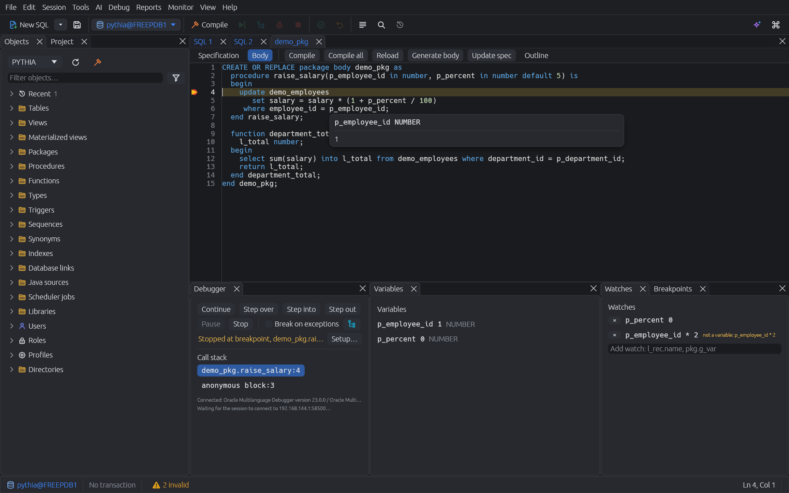

# Pythia

A fast, native Oracle PL/SQL IDE written in Rust (egui on wgpu). It covers the
daily work of an Oracle developer — writing and running SQL, editing and
compiling PL/SQL, debugging, browsing, editing data, comparing schemas and
watching what the database is doing — in one responsive, keyboard-first app
for Linux, Windows and macOS.


## Features

**Editor**
- Rope-backed code editor built for large packages: syntax highlighting,
  multi-cursor, block selection, find/replace with regex, bracket and
  `BEGIN`/`END` matching, comment toggling, case conversion, line moves.
- Context-aware completion: columns after `alias.` (joins, CTEs, inline
  views), package members with signatures, `%ROWTYPE` and cursor records,
  locals and parameters, schema objects and public synonyms.
- Signature help, hover, Ctrl+click / F12 go to definition (also into the
  database), references, live syntax diagnostics and an outline.
- Rename a local variable, parameter, alias or CTE in place (Shift+F6).
- Code folding, numbered bookmarks (Ctrl+Shift+1..9 / Ctrl+1..9) and
  snippets with placeholders (type a trigger, press Tab).


**SQL windows**
- Run the statement under the cursor (Ctrl+Enter), the selection or the
  whole script (F8); SQL\*Plus `exec`, `prompt`, `define`, `desc`, `&vars`.
- Bind and substitution variables in a panel next to the editor, with
  their values (or NULL), which the window keeps. A statement with a
  variable that has no value yet waits there for it; Enter or F8 runs it.
- Results in a virtualized grid: sorting, rectangular selection, aggregates,
  record view, value viewer, copy and export (CSV, TSV, JSON, Excel,
  INSERT statements, Markdown, HTML). Columns can be resized, hidden,
  moved by dragging their header and frozen at the left.
- **Follow foreign keys**: right-click a row to open its parent row or its
  child rows in any table referencing it.
- **Chart any result** as bars or lines: the x axis defaults to the first text
  or date column, numeric columns become series; the chart follows the grid's
  filter and sort.
- **Edit results in place** — no `FOR UPDATE` locks: changes are checked
  against the fetched values when applied, so concurrent modifications are
  reported instead of overwritten. "Show SQL" previews the DML.
- **Execute to file** streams a query of any size into CSV, TSV, JSON,
  INSERT statements or Markdown, with live row count and cancel.
- Explain plan (F5), DBMS_OUTPUT, statement history (Ctrl+E).
- **Errors lead to the code**: each line of a PL/SQL error stack
  (`ORA-06512`) is a link to its package, procedure or trigger at the line,
  with the line's code on hover; **Open where raised** goes straight to
  where the error was raised.


**PL/SQL development**
- Object browser with lazy, virtualized folders, invalid markers, compile,
  drop, describe, query, test; favorites and recently opened objects;
  filters for invalid or recently changed objects; tables expand to
  columns, indexes, constraints, triggers and referencing tables; users
  and roles.
- Create objects from the browser's right-click menu (or File → New
  Object): a table builder (columns with a type picker, primary and
  foreign keys, checks, indexes, identity columns, range, interval, list
  or hash partitioning, temporary tables, a copy of another table), and
  forms for views, materialized views, sequences, synonyms, indexes,
  database links, scheduler jobs, users, roles, profiles and directories,
  with a preview of the generated DDL. Triggers, procedures, functions, packages and types start
  from a form that writes their first source for a program window.
- Form editors for existing sequences, views, materialized views, synonyms,
  indexes, database links, scheduler jobs, users, roles, profiles,
  directories and grants.
- Program windows with spec and body, compile with clickable errors
  (gutter markers and squiggles), unsaved-change tracking, save to file.
  The outline beside the code jumps to a declaration; right-click one to
  test or debug it, go to its body or specification, find its references
  or copy its name.
- **Test…** generates a ready-to-run block for any procedure or function:
  IN parameters as binds, OUT parameters and the result printed, also
  collections (element by element), records, `%ROWTYPE` and objects (field
  by field), ref cursors (row by row), LOBs and XMLTYPE. What a bind can't
  carry, such as a collection or a record, is a local to fill in. **Debug…** runs that
  block under the debugger right away and stops on entry to the
  subprogram. Both are on the right-click menu of procedures, functions and
  package members, in the object browser and in the editors, also on a
  subprogram's name in its own package spec or body and in the program
  window's outline.
- **Debugger** (DBMS_DEBUG_JDWP): breakpoints with conditions and hit
  counts, kept across restarts; break on exception, step over/into/out
  (also through the debugged block itself), run to cursor (Ctrl+F7), call
  stack with subprograms, variables of any frame including records,
  `%ROWTYPE` and collections, watches, values on hover. **Change values
  while stopped**: double-click a variable, field, element or package
  global and the code goes on with the new value (checked against its type
  and precision first; IN parameters and LOBs can't be changed).
  Units with breakpoints are compiled with debug information; Step into
  enters only units that have it (program windows can compile with it,
  Settings → Debugger, and the panel says when a step went over a unit
  without). Its panels (controls and call stack, variables, watches,
  breakpoints, SQL plan) are tabs to arrange as you like.
- **Debugger setup** (*Debug → Debugger Setup…*, the panel's *Setup…*,
  and on its own when a debug run can't connect): the database connects
  back to Pythia to debug, which takes `DEBUG CONNECT SESSION`, a network
  ACL entry for the host it connects to, and a way through firewalls.
  The setup tries every host the database might reach this computer by
  (the address it sees for it, the computer's names, one you type) and
  says for each why it fails: no ACL entry, a name the server can't
  resolve, refused, or dropped on the way. It offers what's missing: a
  host that works, the grants and ACL entry (run as yourself, through a
  saved DBA connection or a user and password, or copied for a DBA), and
  a rule for Windows Firewall, ufw, firewalld or the macOS firewall, run
  with administrator rights after asking. *Debugger ports* (Settings →
  Debugger) fixes the ports the debugger listens on, for firewall rules
  and ACL entries limited to a few.
- **Profiler** (DBMS_HPROF): profile a block or call and see self and
  total time per subprogram and SQL statement; double-click jumps to the
  code. Needs `EXECUTE` on `DBMS_HPROF`; profiling commits.
- Find in database source (Ctrl+Alt+F) with regular expressions.
- **Formatter** (Ctrl+Shift+F) with a live preview of its rules, profiles
  to share a team style, rules learned from existing code (an editor or a
  whole schema), formatting on save, on paste or when a statement's `;` is
  typed, and the AI for statements the rules can't lay out (only
  whitespace and case may change).



**Monitoring**
- Dashboard with plain-language findings ("session 175 blocks 2 sessions —
  likely an uncommitted transaction"), KPIs and live charts.
- Every tile, bar and row on the dashboard leads to the sessions behind
  it; top wait events with their latency histograms.
- Sessions with a hierarchical blocking tree; session details (client and
  connection, transaction, PGA, temp, the PL/SQL it runs, time model,
  captured binds, its own plan, locks, all columns) with cancel, kill,
  disconnect after transaction and SQL trace.
- SQL details: totals, child cursors with their plans and binds, why they
  aren't shared, and the sessions running the statement.
- With the Diagnostics Pack: ASH activity of a session or statement, ASH
  and AWR reports and a statement's plan history; with the Tuning Pack:
  SQL Monitor reports. A built-in tkprof-style trace analyzer.
- MySQL: a dashboard of its own; its threads open their details
  (statement and plan, transaction, locks, the thread they wait for) and
  can be killed.
- PostgreSQL and SQL Server: a dashboard each, from their statistics
  views and DMVs.


**AI assistant**
- Bring your own model: the Anthropic API, any OpenAI-compatible API, a
  local model server (Ollama, llama.cpp, LM Studio) or a command line tool
  (prompt on stdin, answer on stdout). Several can be set up, one is the
  default; API keys live in the OS keychain.
- Generate SQL from a description, using the real tables, columns and
  foreign keys of the connected schema; explain, fix (with the compile or
  run errors) or rewrite the statement under the cursor or the selection,
  then replace it or insert the answer's code with one click.
- Plain-language plan analysis (EXPLAIN PLAN, or the actual plan of a run
  with statistics) with likely problems and concrete fixes; "Analyze with
  AI" on top SQL, session details, AWR/ASH reports and traces.
- A side panel for open-ended questions about the focused window. Table
  definitions, statistics, plans and source go with requests; result rows
  and bind values only if you allow it in Settings → AI, and each answer
  shows what was sent.

**Data and schema tools**
- Schema compare with structural table diffs and safe, ordered sync
  scripts; data compare by key with sync DML.
- Export tables: pick tables, a WHERE per table, CSV/TSV/JSON/INSERT/
  Markdown, one file per table plus DDL, streamed with progress.
- Import CSV/Excel: drop a file, check inferred types (decimal commas,
  date formats), import into a new or existing table with array DML.
  Per column: trim, date format, SQL expression (`upper(:value)`,
  constants); bad rows can be skipped and logged to `<file>.bad.csv`.
- **Maintenance** of a table, materialized view or index (right-click →
  *Maintenance…*), on every database. Its state comes first: when its
  statistics were gathered and whether they are stale or locked, and
  unusable indexes and partitions on Oracle; dead rows and the last
  (auto)vacuum on PostgreSQL; reclaimable space on MySQL; fragmentation on
  SQL Server. Then the database's tasks, with their options and what they
  lock: gather, delete, lock or unlock statistics, rebuild unusable indexes,
  shrink, move (online); `VACUUM`, `ANALYZE`, `REINDEX CONCURRENTLY`;
  `ANALYZE`, `OPTIMIZE` and `CHECK TABLE`; `UPDATE STATISTICS`, rebuild or
  reorganize indexes. The statements run one by one on the window's own
  session, which commits each, with Break; production connections ask
  first.
- **Maintenance scan** of a schema or database (*Tools → Maintenance
  Scan*, or right-click the Tables folder): what the tables need, with the
  evidence and the fix for each, run as a batch object by object. Stale or
  missing statistics and unusable indexes (Oracle), dead rows, wraparound
  and invalid indexes (PostgreSQL), reclaimable space and old statistics
  (MySQL), fragmented indexes, statistics with many changes and the last
  CHECKDB (SQL Server). The dashboards' findings open the fix too.

**Reports**
- Built-in reports (invalid objects, unindexed foreign keys, largest
  segments, top SQL, locks, jobs, …) open as editable queries.
- Save any query as your own report; bind and substitution variables are
  asked for when it runs.

**Scheduler jobs**
- All DBMS_SCHEDULER jobs with state, schedule, last and next run; run now,
  stop, enable, disable, drop; recent runs with errors.
- A form for new jobs and a job's settings: a PL/SQL block or a stored
  procedure, start and end, the repeat interval from presets or as a
  calendar expression, with the next runs it gives.


**Projects and version control**
- Open a folder of SQL and PL/SQL files as a project: git status in the
  tree, a list of changed files, diff with the last commit.
- Compare a file with its object in the database, side by side.
- Export a schema as one file per object (`tables/`, `packages/*.pks|pkb`,
  …) to put it under version control.
- Deploy changed files: a reviewed script of `@file` lines in dependency
  order.


**Safety**
- Every window has its own session and transaction (multi-session); the
  status bar always shows pending transactions; production connections are
  marked red and ask before commit; read-only connections; passwords live
  in the OS keychain.
- One connection for the whole app: with several open, the toolbar, object
  browser, status bar, new windows and SQL windows all use the active one.
  Connecting or picking another moves the SQL windows there (asking first
  about open transactions); program windows keep their connection, named
  in their tab. *Settings → Query → Switch connection per window* gives
  each SQL window a connection of its own instead.

**Appearance**
- Light and dark themes, and an interface zoom that scales everything.
- *Settings → Appearance*: a font file and size for the interface (menus,
  tabs, dialogs, the object browser), a Compact density next to the default
  Comfortable one, or padding, gaps, margins and tree indent set one by
  one; an accent color, square corners, no shadows, scroll bars that are
  always visible, no animations. Object names in the browser can use the
  interface font instead of the code font.
- The result grid's font (code or interface font) and size, striped rows,
  lines between rows and what NULL looks like.
- The editor's font and size, line spacing, and a line, block or underline
  cursor that blinks or not.

**MySQL (experimental)**
- Connect to MySQL (tested with 9.4; MariaDB not yet) with *Type: MySQL* and `host:3306/database`
  (`?tls` for TLS, `?tls=skip-verify` for self-signed certificates); no
  client library needed. The database picked in the object browser is the
  one SQL windows run in; the toolbar and status bar show it. Without a
  database in the profile, the connection starts in the one picked last.
- *Connect through SSH* forwards the connection over an SSH server, like
  `ssh -L` or HeidiSQL's SSH tunnel; the database address is then as the
  SSH server sees it (often `localhost:3306/database`). Log in with a
  password, a key file (OpenSSH or PuTTY `.ppk`) or the SSH agent (Pageant
  or Windows' OpenSSH agent). Host keys come from `~/.ssh/known_hosts`; an
  unknown one is shown with its fingerprint to trust once.
- SQL windows with results, fetching on demand, Break, explain plan,
  completion with columns and comments, and transactions that work as with
  Oracle: queries see what others committed, changes wait for Commit.
  Warnings show as messages.
- *Edit* on a result of one table changes its rows in place, as on
  Oracle. Rows are found by the table's primary key (or a unique key on
  NOT NULL columns), which Pythia adds to the result if the query doesn't
  select it; tables without one stay read-only.
- The object browser lists tables, views, procedures, functions and
  triggers, and the server's users (as `user@host`) and roles; object
  views show columns, indexes, constraints, triggers, grants, dependencies
  and the DDL. *Edit* opens a routine as a script that drops and creates it
  again. Listing every user and role takes `SELECT` on `mysql.user`;
  without it the browser shows your own user and the roles you may use.
- Users and roles have forms (*New user…*, *Edit user…* in the browser):
  host, password, expiry, lock, the roles granted (with admin option, and
  which are enabled at login) and privileges on the server, a database or
  a table, with the grant option. They show the statements before
  *Apply*. Reading other accounts takes `SELECT` on the `mysql` database.
- A monitoring dashboard of its own (Monitor → Dashboard): findings first
  (lock waits and who blocks, metadata locks, connections near the limit,
  buffer pool hit ratio, long transactions, replication), then KPIs and
  trends from `SHOW GLOBAL STATUS`, running statements, open transactions,
  storage and top statements from `performance_schema`. Other users'
  threads, transactions and lock waits need the `PROCESS` privilege; top
  statements and lock waits `SELECT` on `performance_schema`.
- Everything built on Oracle's dictionary or PL/SQL — debugger, profiler,
  the rest of the monitor, reports, scheduler jobs, compare, import/export,
  the other form editors — isn't offered on MySQL connections. As in SQL\*Plus,
  end a routine with `/` on a line of its own (there is no `DELIMITER`).

**PostgreSQL and SQL Server (experimental)**
- *Type: PostgreSQL* with `host:5432/database` (`?sslmode=require` for TLS,
  `verify-full` to check the certificate; a `postgresql://` URL works too),
  and *Type: SQL Server* with `host:1433/database` or `host\instance`
  (`?trust` for a self-signed certificate; an ADO.NET connection string
  works too). Both drivers are pure Rust: no client library needed. Tested
  with PostgreSQL 18 and SQL Server 2022.
- The same tools as on MySQL: SQL windows with results, fetching on demand,
  Break, explain plan (`EXPLAIN (FORMAT JSON)`, `SHOWPLAN_ALL`), completion,
  the object browser (also materialized views and sequences, synonyms on
  SQL Server, and users and roles: PostgreSQL's roles that can log in are
  its users; SQL Server's are the database's) and object views with the
  DDL. Users and roles have forms as on MySQL: on PostgreSQL the role's
  options, password, validity, connection limit, memberships and
  privileges on databases, schemas, tables and sequences; on SQL Server a
  user for a new or existing login (or without one), its default schema,
  role memberships and permissions granted, grantable or denied.
  Transactions work as with
  Oracle; on PostgreSQL a failing statement doesn't abort the transaction,
  and notices (`RAISE NOTICE`) show as messages. Results can't be edited
  in place yet.
- PostgreSQL's monitoring dashboard (Monitor → Dashboard): findings first
  (who blocks whom, sessions idle in transaction, connections near the
  limit, cache hit ratio, deadlocks, replication lag and inactive slots,
  transaction ID wraparound, tables with many dead rows, checkpoints
  forced by WAL volume), then KPIs and trends from `pg_stat_database`,
  active sessions by wait event, connections by user, application, client
  and database, running statements, open transactions, replication, the
  largest databases and tables, and top statements from
  `pg_stat_statements` (when it is loaded). Other users' statements need
  `pg_read_all_stats` (or `pg_monitor`).
- SQL Server's monitoring dashboard: findings first (blocking and who
  blocks, a sleeping session with an open transaction named as such, a
  log nearly full, memory grants pending, low page life expectancy,
  connections near the limit, deadlocks, buffer cache hit ratio, a high
  share of compilations, long transactions and requests), then KPIs and
  trends from the performance counters, running requests by wait class,
  sessions by login, host, program and database, blocking, open
  transactions with their log use, top waits since the refresh before,
  database and table sizes, and top statements from the plan cache. Most
  of it needs `VIEW SERVER STATE` (`VIEW SERVER PERFORMANCE STATE` on
  2022); without it the dashboard shows the login's own sessions and says
  so.
- Session details from the dashboards: a PostgreSQL backend's connection,
  statement, transaction (and how far its snapshot holds back VACUUM),
  locks and who blocks whom, with *Cancel query* and *Terminate*; a SQL
  Server session's connection, request with its cached plan, transactions
  with log used, locks and blocking, with *Kill*.
- *Connect through SSH* as on MySQL: the address is the database as the
  SSH server sees it, e.g. `localhost:5432/database`. On SQL Server give
  the port, not `host\instance`: the SQL Server Browser can't be reached
  through a tunnel.
- Scripts split the database's way: PostgreSQL's dollar-quoted routine
  bodies stay whole and `::` casts aren't bind variables; on SQL Server,
  `GO` on a line of its own ends a batch, routines and scripts with
  `DECLARE`d variables run up to the next `GO`, and `BEGIN … END` blocks
  keep their `;`. *Edit* opens a routine as `CREATE OR REPLACE` (PostgreSQL)
  or `CREATE OR ALTER` (SQL Server).
- On SQL Server a batch shows its first result set; `PRINT` output and
  informational messages show as messages, in order with it. After Break,
  the connection is opened again: the driver can't go on after a cancel,
  so changes that weren't committed are rolled back. The driver is our
  fork of [tiberius](https://github.com/ortic/tiberius) (branch `pythia`),
  which passes those messages on.

## Installing

Download Pythia from [its website](https://ortic.github.io/pythia/#download).
Packages for Linux (`.deb`, AppImage), Windows (MSI, setup `.exe`) and
macOS (`.dmg`) are attached to each [GitHub
release](https://github.com/ortic/pythia/releases), in two flavors:
`pythia_…` with the pure-Rust driver, and `pythia-instantclient_…` on the
Oracle Instant Client (see below). Take the first unless you need the
second.

Pythia connects to Oracle directly, with a pure-Rust driver: **no Oracle
client libraries are needed**. Easy Connect strings (`host:port/service`)
work as they are; for net service names, point `TNS_ADMIN` at the directory
with your `tnsnames.ora` (or put it into `$ORACLE_HOME/network/admin`), and
Pythia offers the aliases when connecting. The tnsnames.ora of an Oracle
Client that is already installed is found the way Oracle finds it: through
the registry on Windows (`TNS_ADMIN`, the Oracle homes) and the library path.

**Database versions:** Pythia is developed against Oracle 23ai and tested
against 18c XE and 21c XE. A few features need a newer release: the
profiler, *Cancel current SQL* in the monitor and restarting a sequence need
18c; reading trace files through the database needs 12.2.

Proxy authentication works with the usual `proxy_user[target_user]` user
name. TLS (TCPS) works, cancelling a running statement included; the
driver's tests run over TLS too, while Pythia itself hasn't been tried on a
TLS server yet. For a server certificate from a private CA, put the CA's
certificate as `ewallet.pem` in a folder and name it in the connect string:
`tcps://host:2484/service?wallet_location=/path/to/folder`, or
`(SECURITY=(MY_WALLET_DIRECTORY=/path/to/folder))` in tnsnames.ora.
`TIMESTAMP WITH TIME ZONE` values with a region show the region's name
(`2026-07-01 12:00:00 Europe/Zurich`); its offset comes from the IANA time
zone rules built into Pythia, which can differ from the server's time zone
file for very old dates and for rule changes newer than that file.

**When you need the Oracle Instant Client:** Oracle 11.2 databases (12.1 is
untested), servers that *require* Native Network Encryption (connecting
fails with *not implemented: Native Network Encryption and Data
Integrity*; the server has `SQLNET.ENCRYPTION_SERVER = REQUIRED`, use TLS
instead where you can), and OS or wallet logins (`/@alias`). For these,
install a `pythia-instantclient_…` package and the [Instant
Client](https://www.oracle.com/database/technologies/instant-client/downloads.html)
(*Basic* or *Basic Light*; on Linux also `libaio`), or use an Oracle Client
that is already installed. Pythia loads it when connecting; it has to be on
the library path: `PATH` on Windows, on Linux registered with `ldconfig`
(the Instant Client RPMs do this) or in `LD_LIBRARY_PATH`, on macOS linked
into `~/lib` (`ln -s ~/Downloads/instantclient_23_3/libclntsh.dylib ~/lib/`).
Instant Client 23 connects to Oracle 19c and later; for 11.2 take Instant
Client 19. The Oracle client resolves net service names itself (`TNS_ADMIN`,
its `network/admin` directory, `sqlnet.ora`). *Help → About Pythia* shows
which driver a build uses and the client version it found. Installing one
flavor replaces the other; settings and connections stay. To build this
flavor yourself: `cargo build --release --features pythia-db/thick`.

**WSL:** under WSLg, Pythia opens its window through X11 (Xwayland), since
WSLg's compositor crashes on Wayland windows like Pythia's
([microsoft/wslg#1386](https://github.com/microsoft/wslg/issues/1386)).
`PYTHIA_WAYLAND=1` keeps Wayland. Through X11 the window starts at 96 DPI
whatever Windows' display scaling; on a scaled display, size the UI with
Settings → UI scale (or Ctrl + / Ctrl −).

## Building from source

Requirements: Rust (stable).

```sh
cargo build --release
./target/release/pythia
```

To run an optimized build while working on Pythia, use the `fast` profile:
a change rebuilds in 5–15 seconds, where a release build takes about two
minutes for its link-time optimization.

```sh
cargo run --profile fast -p pythia-app
```

The database driver is our fork of
[rust-oracledb](https://github.com/ortic/rust-oracledb) (branch `pythia`:
upstream fixes that aren't released yet, and cancelling a running call),
pinned to a commit in `Cargo.toml`.

Packages are built with [cargo-packager](https://github.com/crabnebula-dev/cargo-packager)
(`cargo install cargo-packager --locked`):

```sh
cargo packager --release -p pythia-app            # all formats of this platform
cargo packager --release -p pythia-app -f deb     # just one
```

The output lands in `target/packages`. Releases are built by
`.github/workflows/release.yml` when a `v*` tag is pushed.

## Development

A local Oracle Free database for development and tests:

```sh
docker compose up -d        # or: podman compose up -d
```

Tests that need the database are skipped unless configured:

```sh
PYTHIA_TEST_DB=pythia/pythia@localhost:1521/FREEPDB1 cargo test
```

`--features pythia-db/thick` runs them against the Instant Client instead
(set `LD_LIBRARY_PATH`); `cargo run -p pythia-db --example thin_probe
--features thick` compares the two drivers.

Test runs on one machine share the test databases: the first connection
of a run takes a lock (`pythia-test-databases.lock` in the temp
directory) that the test process keeps, so a second run, e.g. in another
worktree, waits for it instead of failing on the same objects.

| Variable | Used by |
|---|---|
| `PYTHIA_TEST_DB` | integration tests (app user) |
| `PYTHIA_TEST_MYSQL` | MySQL tests, e.g. `pythia/pythia@localhost:3306/pythia` for `docker compose up -d mysql` |
| `PYTHIA_TEST_MYSQL_DBA` | MySQL dashboard tests that need privileges, e.g. `root/mysql@localhost:3306/pythia` |
| `PYTHIA_TEST_SSH`, `PYTHIA_TEST_MYSQL_VIA_SSH` | SSH tunnel tests: `pythia:pythia@localhost:2222` and `pythia/pythia@mysql:3306/pythia` for `docker compose up -d mysql ssh` |
| `PYTHIA_TEST_POSTGRES_VIA_SSH` | PostgreSQL through the SSH tunnel test (with `PYTHIA_TEST_SSH`): `pythia/pythia@postgres:5432/pythia` for `docker compose up -d postgres ssh` |
| `PYTHIA_TEST_MSSQL_VIA_SSH` | SQL Server through the SSH tunnel test (with `PYTHIA_TEST_SSH`): `pythia/pythia@mssql:1433/pythia?trust` for `docker compose up -d mssql ssh` |
| `PYTHIA_TEST_POSTGRES` | PostgreSQL tests (a superuser), e.g. `pythia/pythia@localhost:5432/pythia` for `docker compose up -d postgres`, which loads `pg_stat_statements` |
| `PYTHIA_TEST_MSSQL` | SQL Server tests, e.g. `pythia/pythia@localhost:1433/pythia?trust` for `docker compose up -d mssql mssql-init` |
| `PYTHIA_TEST_MSSQL_DBA` | SQL Server dashboard tests that need VIEW SERVER STATE, e.g. `sa/Pythia-2026@localhost:1433/pythia?trust` |
| `PYTHIA_TEST_DB_DBA` | monitor, compare and debugger tests (`system/oracle@…`) |
| `PYTHIA_DEBUG_HOST` | debugger tests: how the database reaches this machine (`host.containers.internal` for a local Podman container; with Docker on Linux, the compose network's gateway from `docker network inspect pythia_default`) |
| `PYTHIA_SCREENSHOT_DIR` | renders the real UI offscreen into PNGs (`cargo test -p pythia-app screenshots`) |

The debugger needs `DEBUG CONNECT SESSION`, `DEBUG ANY PROCEDURE` and a JDWP
network ACL; `pythia_debugger::target::setup_script` prints what a DBA has to
run (the app's *Debugger Setup…* finds and fixes the same). `crates/pythia-debugger/tests/scenario.rs` steps through a larger
scenario (packages, records, collections, an object type, a trigger).

The tests set up what they need on a new database: the demo schema
several app tests use, and, with `PYTHIA_TEST_DB_DBA` set,
`SELECT_CATALOG_ROLE` and the debugger privileges for the test user
(without a DBA, grant those yourself). CI runs the whole suite against a
fresh Oracle Free container.

### Workspace

| Crate | Purpose |
|---|---|
| `pythia-app` | the application: documents, docking, commands, dialogs |
| `pythia-ui` | code editor, data grid, icon set |
| `pythia-db` | sessions on worker threads (Oracle, MySQL, PostgreSQL, SQL Server), dictionary queries, what each database supports (`Dialect`, `Feature`), SSH tunnels |
| `pythia-plsql` | lexer, statement splitter, error-tolerant parser |
| `pythia-lsp-core` | completion, hover, navigation, outline, diagnostics |
| `pythia-data` | export and import |
| `pythia-debugger` | JDWP debugger and panel |
| `pythia-monitor` | dashboard, sessions, AWR/ASH, trace analyzer |
| `pythia-compare` | schema and data compare |
| `pythia-ai` | AI backends (HTTP, command line), prompts and the data policy |
| `pythia-config` | settings and saved connections |

See [CONCEPT.md](CONCEPT.md) for the full plan and status.

## Keyboard

| Key | Action |
|---|---|
| Ctrl+Enter / F8 | Execute statement / selection or script |
| F5 | Explain plan |
| Shift+Esc | Cancel running statement |
| F10 / Shift+F10 | Commit / rollback |
| Ctrl+Space | Completion |
| F12, Ctrl+click | Go to definition |
| Ctrl+E | Statement history |
| Ctrl+Shift+O | Find database object |
| Ctrl+Alt+F | Find in database source |
| Ctrl+Shift+P | Command palette |
| Ctrl+F9 | Debug block under cursor |
| Ctrl+B | Toggle breakpoint |
| F9 / F6 / F7 / Shift+F7 / Shift+F9 | Continue / step over / into / out / stop |
| Ctrl+F7 | Run to cursor (while debugging) |
| Ctrl+O / Ctrl+S | Open / save file |
| Shift+F6 | Rename symbol |
| Ctrl+Shift+[ / ] | Fold / unfold |
| Ctrl+Shift+1..9, Ctrl+1..9 | Set / jump to bookmark |
| Ctrl+, | Settings |

All application shortcuts can be changed in Settings → Keyboard.
